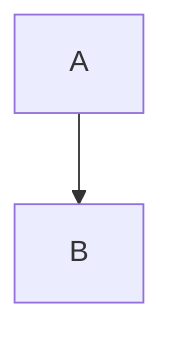

# Phase 00 — Foundation

> **Duration estimate:** 2 weeks (about 8–10 working sessions).
> **Goal:** Create the Git repository, the Dart pub workspace (Flutter app + 7 pure-Dart packages), the app shell (logging,
> crash handlers, theme, localisation, placeholder screen), the developer tooling (licence check, Dev Launcher entry, CI,
> fixture vaults, benchmark-vault generator) and run the spikes that decide the editor engine and prove the risky platform
> features (SQLite FTS5, Android shared storage, Windows tray + second window). No product features are built in this phase.

Read `GEMINI.md` and `instructions/00-conventions.md` before you start. This file uses "per conventions §N" to point at
the contract; it never redefines it. Where this file and the conventions disagree, the conventions win (write the conflict
into `PROGRESS.md`).

---

## Before you start

Prerequisites:
- None (this is the first phase). The human has answered the product decisions (name **Tephra**, id `com.tephra.app`).

What already exists in `D:\script\tephra-gemini\` (the folder is **not yet** a Git repository):
- `GEMINI.md`, `AGENTS.md`
- `PROGRESS.md` (created by the human; if it is missing, stop and ask the human for it)
- `instructions/00-conventions.md`, `instructions/phase-00-foundation.md` (this file), `instructions/phase-01-vault-editor.md`
- `docs/plan/IMPLEMENTATION_PLAN.md`, `docs/plan/PHASE_PLAN.md`

Machine facts (already installed — never reinstall): see `GEMINI.md` §2. Flutter 3.47.7 / Dart 3.13.5 at `D:\dev\flutter`,
Android SDK at `D:\dev\android-sdk`, JDK 17, VS Build Tools 2022, Windows Developer Mode on, Dev Launcher at
`http://127.0.0.1:7799`.

Rules that matter most in this phase:
- Work only inside `D:\script\tephra-gemini\`. Never open `D:\script\note taking app\`.
- Use your file-writing tool to create files. Do not use shell heredocs or `echo` to write source files.
- PowerShell 5.1: chain with `;` (never `&&`).
- First line of every Dart file you create: `// © 2026 Tephra. All rights reserved.`

---

## What exists when this phase is done

- Git repository on branch `main` with tag `v0.00.0`; work done on branch `phase-00` and merged with `--no-ff`.
- `.gitignore`, `.gitattributes`, `README.md` (with `## Install` and `## Run`), `THIRD_PARTY_NOTICES.md` (generated).
- Root `pubspec.yaml` (workspace `tephra_workspace`) and root `analysis_options.yaml` (per conventions §5.2).
- `app/` — Flutter app `tephra` for Android, Windows and web, id `com.tephra.app`, display name `Tephra`, min SDK 26:
  - `lib/main.dart`, `lib/app.dart`, `lib/core/logging.dart`, `lib/theme/app_theme.dart`, `lib/l10n/app_en.arb` (+ generated
    `app_localizations*.dart`), `lib/welcome/welcome_screen.dart`, `l10n.yaml`, `dart_test.yaml`
  - tests: `test/app_test.dart`, `test/core/logging_test.dart`, `test/welcome/welcome_screen_test.dart`
- `packages/tephra_core`, `tephra_markdown`, `tephra_vault`, `tephra_index`, `tephra_search`, `tephra_sync`, `tephra_io` —
  empty libraries with correct pubspecs and inter-package dependencies per conventions §3.
- `tool/dev.dart`, `tool/check_licenses.dart`, `tool/gen_test_vaults.dart`, `tool/gen_bench_vault.dart`,
  `tool/src/license_classifier.dart`, `tool/src/bench_generator.dart`, `tool/src/png_writer.dart`, `tool/src/huge_note.dart`,
  `tool/test/*.dart`, `tool/license_overrides.json`.
- `.github/workflows/ci.yml` (jobs `checks`, `android`, `windows`), verified locally.
- `test_vaults/README.md`, `test_vaults/syntax/` (23 notes + attachments), `test_vaults/edge/` (generated, byte-exact),
  `test_vaults/real/` (generated 300-note vault), `test_vaults/bench/` (generated on demand, git-ignored).
- Spikes (throwaway apps, not in the workspace): `docs/spikes/editor_spike/`, `docs/spikes/drift_spike/`,
  `docs/spikes/android_storage_spike/`, `docs/spikes/windows_desktop_spike/`.
- Reports: `docs/spikes/editor.md`, `docs/spikes/drift-fts5.md`, `docs/spikes/android-storage.md`,
  `docs/spikes/windows-desktop.md`; decision record `docs/decisions/0001-editor-engine.md`.
- The project registered in Dev Launcher as **"Tephra (Gemini build)"** on port 8093 and verified starting.

---

## Dependencies added in this phase

Add app dependencies with `flutter pub add <names>` run inside `app/`. Add package dependencies with `dart pub add <name>`
run inside the package folder. Root-workspace dependencies are written by hand in the root `pubspec.yaml` (step 00.3).
After every dependency change run `flutter pub get` at the repo root and then `dart run tool/check_licenses.dart`
(from step 00.8 on; before 00.8 exists, run it as soon as 00.8 is done).

| Package | Where | Purpose | Licence |
|---|---|---|---|
| `flutter_lints` ^6.0.0 | root (dev) | shared lint set | BSD-3-Clause |
| `test` ^1.25.6 | root (dev), every package (dev) | `dart test` | BSD-3-Clause |
| `path` ^1.9.1 | root (for `tool/`), app | path joining | BSD-3-Clause |
| `flutter_localizations` (sdk) | app | Material localisations | BSD-3-Clause (Flutter SDK) |
| `flutter_riverpod` ^3.4.3 | app | state management (Riverpod 3, no codegen) | MIT |
| `logging` ^1.3.0 | app | logging | BSD-3-Clause |
| `path_provider` ^2.1.6 | app | app support directory | BSD-3-Clause |
| `intl` ^0.20.3 | app | l10n runtime | BSD-3-Clause |

Spike-only dependencies (inside `docs/spikes/*`, never in the workspace): `re_editor` (MIT), `drift` (MIT),
`drift_flutter` (MIT), `permission_handler` (MIT), `watcher` (BSD-3-Clause), `tray_manager` (MIT),
`desktop_multi_window` (MIT/Apache-2.0 — check the LICENSE file), `path_provider` (BSD-3-Clause).

---

## Steps

### 00.1 Verify the machine

**Purpose** Confirm the pre-installed toolchain works before anything is created. Nothing is installed in this step
unless a check below explicitly says so.

**Files** None created. Results go into `PROGRESS.md` (notes line of this step).

**Implementation**
1. In PowerShell run, one at a time, and keep the output:
   ```
   flutter --version
   dart --version
   flutter doctor -v
   flutter devices
   flutter emulators
   git --version
   java -version
   ```
2. Expected: Flutter `3.47.7` channel stable, Dart `3.13.5`, `flutter doctor` shows no `[✗]` for Flutter, Android
   toolchain, Visual Studio, Windows Version. `[!]` for Chrome or Android Studio is acceptable (Android Studio is not needed).
   If `flutter` is not found, use `D:\dev\flutter\bin\flutter.bat` with the full path and note it.
3. Emulator: if `flutter emulators` lists at least one emulator, note its id. If it lists none, create one:
   ```
   & "$env:ANDROID_HOME\cmdline-tools\latest\bin\sdkmanager.bat" "emulator" "system-images;android-36;google_apis;x86_64"
   & "$env:ANDROID_HOME\cmdline-tools\latest\bin\avdmanager.bat" create avd -n tephra_api36 -k "system-images;android-36;google_apis;x86_64" -d pixel_7
   flutter emulators --launch tephra_api36
   ```
   If `cmdline-tools\latest` does not exist, list `$env:ANDROID_HOME\cmdline-tools` and use the folder that exists.
   If the emulator refuses to start because of a missing hypervisor (WHPX / "x86 emulation currently requires hardware
   acceleration"), stop and ask the human (it needs Windows admin rights). Do not try to change Windows features yourself.
4. Ask the human whether a real Android phone can be connected (USB debugging or wireless debugging). Several exit-gate
   items in this phase need a real phone. If none is available now, continue; record "phone not connected" in `PROGRESS.md`.

**Tests** None.

**Verify** `flutter doctor -v` output contains `Flutter (Channel stable, 3.47.7` and `• No issues found!` or only `[!]`
lines for Chrome / Android Studio. `flutter devices` lists `Windows (desktop)`.

**Pitfalls**
- Do not run `flutter upgrade`, `flutter channel` or install another Flutter. The version is pinned to 3.47.7.
- Do not accept or change anything under `D:\dev\` except through `sdkmanager`/`avdmanager` as above.

---

### 00.2 Git repository, ignore and attribute files

**Purpose** Make the folder a Git repository with safe ignore rules and line-ending rules that keep fixture files byte-exact.

**Files**
- create `.gitignore`
- create `.gitattributes`

**Implementation**
1. Create `.gitignore` with exactly these lines (order and comments as shown):
   ```
   # Dart / Flutter
   .dart_tool/
   .packages
   build/
   .flutter-plugins
   .flutter-plugins-dependencies
   pubspec_overrides.yaml
   coverage/

   # Secrets — never commit (only *.example.json templates are committed)
   secrets/*
   !secrets/*.example.json
   *.jks
   *.keystore
   key.properties
   client_secret*.json
   .env

   # Android local files
   android/local.properties
   app/android/local.properties
   **/android/.gradle/
   **/android/app/.cxx/

   # Generated fixtures
   test_vaults/bench/

   # IDE / OS
   .idea/
   .vscode/
   *.iml
   .DS_Store
   Thumbs.db
   ```
2. Create `.gitattributes` with exactly:
   ```
   * text=auto eol=lf
   *.bat text eol=crlf
   *.cmd text eol=crlf
   *.ps1 text eol=crlf
   *.rc text eol=crlf
   *.png binary
   *.ico binary
   *.jpg binary
   *.pdf binary
   *.mp3 binary
   *.mp4 binary
   test_vaults/** -text
   ```
   The last line makes Git store every fixture byte-for-byte (CRLF and BOM files must not be converted).
3. Initialise the repository and make the first commit on `main`, then create the phase branch:
   ```
   git init -b main
   git config core.autocrlf false
   git config core.quotepath false
   git add -A
   git commit -m "phase 00.0: add plans, conventions and agent rules"
   git checkout -b phase-00
   ```
   Then commit this step: `git add -A; git commit -m "phase 00.2: add gitignore and gitattributes"`.

**Tests** None.

**Verify** `git status` prints `On branch phase-00` and `nothing to commit, working tree clean`. `git log --oneline` shows two commits.

**Pitfalls**
- Do not skip `core.autocrlf false`: Git for Windows defaults to `true` and would rewrite CRLF fixture files.
- Never add a remote. The human creates the private GitHub repository later.

---

### 00.3 Workspace root: pubspec and analysis options

**Purpose** Create the Dart pub workspace root and the single shared lint configuration (conventions §2, §4, §5.2).

**Files**
- create `pubspec.yaml`
- create `analysis_options.yaml`

**Implementation**
1. Create `pubspec.yaml` exactly:
   ```yaml
   name: tephra_workspace
   description: "Tephra workspace root: shared tooling and lints."
   publish_to: none
   environment:
     sdk: ^3.13.0
   workspace:
     - app
     - packages/tephra_core
     - packages/tephra_markdown
     - packages/tephra_vault
     - packages/tephra_index
     - packages/tephra_search
     - packages/tephra_sync
     - packages/tephra_io
   dependencies:
     path: ^1.9.1
   dev_dependencies:
     flutter_lints: ^6.0.0
     test: ^1.25.6
   ```
   (`path` and `test` are used by `tool/` scripts and `tool/test/`.)
2. Create `analysis_options.yaml` exactly:
   ```yaml
   include: package:flutter_lints/flutter.yaml

   analyzer:
     language:
       strict-casts: true
       strict-inference: true
       strict-raw-types: true
     errors:
       unused_import: error
       missing_return: error
     exclude:
       - "**/*.g.dart"
       - "**/build/**"
       - "test_vaults/**"
       - "docs/spikes/**"
       - "app/lib/l10n/app_localizations*.dart"

   linter:
     rules:
       - always_declare_return_types
       - avoid_dynamic_calls
       - avoid_print
       - avoid_slow_async_io
       - cancel_subscriptions
       - close_sinks
       - directives_ordering
       - prefer_final_fields
       - prefer_final_locals
       - prefer_single_quotes
       - require_trailing_commas
       - sort_constructors_first
       - throw_in_finally
       - unawaited_futures
       - use_super_parameters
   ```
   Do **not** add `unnecessary_await_in_return` (deprecated; it causes a `deprecated_lint` warning).
   The extra excludes `docs/spikes/**` (throwaway apps) and the generated l10n files are additions to conventions §5.2,
   not changes.

**Tests** None (nothing to run until the members exist).

**Verify** Both files exist. `pub get` is run in step 00.6 after the members exist.

**Pitfalls**
- YAML: any value containing `: ` must be quoted. The description above is quoted on purpose.
- Do not run `flutter pub get` yet — it fails because the workspace members do not exist.

---

### 00.4 Create the Flutter app and set its identity

**Purpose** Create `app/` and give it the permanent identity `com.tephra.app` / `Tephra` on every platform.

**Files**
- create (via `flutter create`) `app/`
- modify `app/android/app/build.gradle.kts`
- move `app/android/app/src/main/kotlin/com/tephra/tephra/MainActivity.kt` → `app/android/app/src/main/kotlin/com/tephra/app/MainActivity.kt`
- modify `app/android/app/src/main/AndroidManifest.xml`
- modify `app/windows/runner/main.cpp`, `app/windows/runner/Runner.rc`
- modify `app/web/index.html`, `app/web/manifest.json`
- modify `app/pubspec.yaml`
- delete `app/analysis_options.yaml`, `app/test/widget_test.dart`

**Implementation**
1. From the repo root run:
   ```
   flutter create --no-pub --platforms=android,windows,web --org com.tephra --project-name tephra app
   ```
2. `app/android/app/build.gradle.kts`: change `namespace = "com.tephra.tephra"` to `namespace = "com.tephra.app"`;
   change `applicationId = "com.tephra.tephra"` to `applicationId = "com.tephra.app"`; change
   `minSdk = flutter.minSdkVersion` to `minSdk = 26` (conventions §1). Delete the `// TODO: Specify your own unique
   Application ID` comment line. Leave everything else unchanged.
3. Create `app/android/app/src/main/kotlin/com/tephra/app/MainActivity.kt` with exactly:
   ```kotlin
   package com.tephra.app

   import io.flutter.embedding.android.FlutterActivity

   class MainActivity : FlutterActivity()
   ```
   Then delete the folder `app/android/app/src/main/kotlin/com/tephra/tephra/` (including the old `MainActivity.kt`).
4. `app/android/app/src/main/AndroidManifest.xml`: change `android:label="tephra"` to `android:label="Tephra"`.
5. `app/windows/runner/main.cpp`: change `window.Create(L"tephra", origin, size)` to `window.Create(L"Tephra", origin, size)`.
6. `app/windows/runner/Runner.rc`, in the `StringFileInfo` block, set exactly these values (keep `InternalName "tephra"` and
   `OriginalFilename "tephra.exe"` unchanged):
   ```
   VALUE "CompanyName", "Tephra" "\0"
   VALUE "FileDescription", "Tephra" "\0"
   VALUE "LegalCopyright", "(C) 2026 Tephra. All rights reserved." "\0"
   VALUE "ProductName", "Tephra" "\0"
   ```
7. `app/web/index.html`: `<title>tephra</title>` → `<title>Tephra</title>`; `content="tephra"` in the
   `apple-mobile-web-app-title` meta → `content="Tephra"`; the `description` meta content → `Tephra (development preview)`.
8. `app/web/manifest.json`: `"name": "Tephra"`, `"short_name": "Tephra"`, `"description": "Tephra (development preview)"`.
9. Replace `app/pubspec.yaml` completely with:
   ```yaml
   name: tephra
   description: "Tephra, an Obsidian-compatible Markdown notes app for Android and Windows."
   publish_to: none
   version: 0.0.0+1
   resolution: workspace

   environment:
     sdk: ^3.13.0

   dependencies:
     flutter:
       sdk: flutter
     tephra_core:
       path: ../packages/tephra_core
     tephra_markdown:
       path: ../packages/tephra_markdown
     tephra_vault:
       path: ../packages/tephra_vault
     tephra_index:
       path: ../packages/tephra_index
     tephra_search:
       path: ../packages/tephra_search
     tephra_sync:
       path: ../packages/tephra_sync
     tephra_io:
       path: ../packages/tephra_io

   dev_dependencies:
     flutter_test:
       sdk: flutter

   flutter:
     uses-material-design: true
     generate: true
   ```
   (`cupertino_icons` and `flutter_lints` are removed on purpose; lints come from the root.)
10. Delete `app/analysis_options.yaml` (so the root one applies) and `app/test/widget_test.dart` (replaced in 00.7).
11. Do not run `pub get` yet (the packages do not exist). Commit: `phase 00.4: create Flutter app with Tephra identity`.

**Tests** None in this step (the app is compiled in 00.6 and tested in 00.7).

**Verify**
- `Select-String -Path app\android\app\build.gradle.kts -Pattern 'com.tephra.app'` returns 2 lines.
- `Test-Path app\android\app\src\main\kotlin\com\tephra\tephra` → `False`; `Test-Path app\android\app\src\main\kotlin\com\tephra\app\MainActivity.kt` → `True`.
- `Select-String -Path app\windows\runner\main.cpp -Pattern 'L"Tephra"'` returns 1 line.

**Pitfalls**
- The Kotlin `package` line must match the new folder, or the app crashes at start with `ClassNotFoundException`.
- Do not change `BINARY_NAME` in `app/windows/CMakeLists.txt`; the executable stays `tephra.exe`.
- Do not touch `app/android/app/src/main/res/` or icons in this phase.

---

### 00.5 Create the seven packages

**Purpose** Create the pure-Dart packages with correct pubspecs and the dependency graph of conventions §3.

**Files** For each `<x>` in `core, markdown, vault, index, search, sync, io`:
- create `packages/tephra_<x>/pubspec.yaml`, `packages/tephra_<x>/README.md`, `packages/tephra_<x>/lib/tephra_<x>.dart`
- delete template files listed below

**Implementation**
1. For each package run from the repo root:
   ```
   dart create -t package --no-pub packages/tephra_core
   dart create -t package --no-pub packages/tephra_markdown
   dart create -t package --no-pub packages/tephra_vault
   dart create -t package --no-pub packages/tephra_index
   dart create -t package --no-pub packages/tephra_search
   dart create -t package --no-pub packages/tephra_sync
   dart create -t package --no-pub packages/tephra_io
   ```
2. In **each** package delete: `example/` (whole folder), `CHANGELOG.md`, `analysis_options.yaml`, `.gitignore`,
   `lib/src/tephra_<x>_base.dart`, `test/tephra_<x>_test.dart`, and then the now-empty `lib/src/` and `test/` folders.
3. Write each `pubspec.yaml` with this template (replace name, description and dependencies):
   ```yaml
   name: tephra_core
   description: "Core types for Tephra: vault paths, exceptions, clock and hashing."
   version: 0.0.1
   publish_to: none
   resolution: workspace

   environment:
     sdk: ^3.13.0

   dev_dependencies:
     test: ^1.25.6
   ```
   Names, descriptions and `dependencies:` blocks (path dependencies only, exactly as conventions §3):

   | Package | description (quoted) | dependencies |
   |---|---|---|
   | tephra_core | `"Core types for Tephra: vault paths, exceptions, clock and hashing."` | none |
   | tephra_markdown | `"Markdown parser with Obsidian extensions and source offsets for Tephra."` | tephra_core |
   | tephra_vault | `"Vault file system, text round-trip and file watching for Tephra."` | tephra_core |
   | tephra_index | `"SQLite note index for Tephra."` | tephra_core, tephra_markdown, tephra_vault |
   | tephra_search | `"Obsidian search syntax parser and engine for Tephra."` | tephra_core, tephra_markdown, tephra_index |
   | tephra_sync | `"Encrypted sync and backup engine for Tephra."` | tephra_core, tephra_vault |
   | tephra_io | `"Importers and exporters for Tephra."` | tephra_core, tephra_markdown, tephra_vault |

   A dependency block looks like:
   ```yaml
   dependencies:
     tephra_core:
       path: ../tephra_core
   ```
4. Write each `lib/tephra_<x>.dart` as (example for core; adapt the doc sentence to the package description):
   ```dart
   // © 2026 Tephra. All rights reserved.

   /// Core types shared by every Tephra package: vault paths, exceptions, clock and hashing.
   library;
   ```
   No `export` lines yet — the packages are empty in Phase 0.
5. Write each `README.md` as a heading `# tephra_<x>` plus one sentence (the description) plus the line
   `Pure Dart. Must not import package:flutter (see instructions/00-conventions.md §3).`

**Tests** None yet. Packages have no `test/` folder in Phase 0; CI and the verify loops skip packages without tests.

**Verify** `Get-ChildItem packages -Directory | Select-Object Name` lists exactly the 7 packages.
`Get-ChildItem -Recurse packages -Filter analysis_options.yaml` returns nothing.

**Pitfalls**
- A description containing `: ` without quotes makes `pub get` fail with a YAML error. Every description above is quoted.
- Do not keep `lints` from the template pubspec; lints come from the root `flutter_lints`.
- Do not add a dependency that conventions §3 does not allow (for example `tephra_vault` → `tephra_markdown` is forbidden).

---

### 00.6 First resolve, analyze and format baseline

**Purpose** Prove the workspace resolves as one unit and that the empty skeleton is lint-clean.

**Files** Generated: `pubspec.lock`, `.dart_tool/` (git-ignored).

**Implementation**
1. At the repo root: `flutter pub get`. It must finish with `Got dependencies!` and create exactly one `pubspec.lock` at
   the root (none inside `app/` or `packages/*`). If it says "Please enable Developer Mode", stop and tell the human.
2. Add the app dependencies (run inside `app/`):
   ```
   cd app
   flutter pub add flutter_riverpod logging path path_provider intl
   flutter pub add flutter_localizations --sdk=flutter
   cd ..
   flutter pub get
   ```
   Check that `app/pubspec.yaml` now lists these dependencies with caret constraints that allow the versions in
   conventions §4 (`flutter_riverpod ^3.4.3`, `logging ^1.3.0`, `path ^1.9.1`, `path_provider ^2.1.6`, `intl ^0.20.3`).
   If `pub add` chose an older major version, stop and report it.
3. Run the standard checks:
   ```
   dart format --output=none --set-exit-if-changed app/lib app/test packages tool
   flutter analyze --fatal-infos
   ```
   `tool` and `app/test` may not exist yet; if `dart format` complains that a path does not exist, create the folder
   (`New-Item -ItemType Directory -Force tool`, `New-Item -ItemType Directory -Force app\test`) and rerun.
   The template `app/lib/main.dart` may produce lint infos; fix them now by replacing `app/lib/main.dart` with a minimal
   version (it is fully rewritten in 00.7):
   ```dart
   // © 2026 Tephra. All rights reserved.
   import 'package:flutter/material.dart';

   void main() {
     runApp(const MaterialApp(home: Scaffold(body: Center(child: Text('Tephra')))));
   }
   ```
   (This placeholder contains a hard-coded string; it is removed in 00.7.)

**Tests** None.

**Verify** `flutter pub get` → `Got dependencies!`. `Test-Path app\pubspec.lock` → `False`. `flutter analyze --fatal-infos`
→ `No issues found!`. `dart format ...` exit code 0.

**Pitfalls**
- Always run `pub get` at the repo root. Running it inside `app/` also works in a workspace, but never delete the root lockfile.
- If analysis reports `include_file_not_found` for `package:flutter_lints/flutter.yaml`, the root `pub get` did not run.

---

### 00.7 App shell: logging, crash handlers, theme, localisation, welcome screen

**Purpose** A real app skeleton that every later phase builds on (conventions §2, §5.5, §5.7, §5.10).

**Files**
- create `app/l10n.yaml`, `app/lib/l10n/app_en.arb`, generated `app/lib/l10n/app_localizations.dart` and `app_localizations_en.dart`
- create `app/lib/core/logging.dart`
- create `app/lib/theme/app_theme.dart`
- create `app/lib/welcome/welcome_screen.dart`
- create `app/lib/app.dart`
- rewrite `app/lib/main.dart`
- create `app/dart_test.yaml`
- create tests `app/test/app_test.dart`, `app/test/core/logging_test.dart`, `app/test/welcome/welcome_screen_test.dart`

**Implementation**
1. `app/l10n.yaml` exactly:
   ```yaml
   arb-dir: lib/l10n
   template-arb-file: app_en.arb
   output-localization-file: app_localizations.dart
   output-class: AppLocalizations
   nullable-getter: false
   format: true
   ```
   Do **not** add `synthetic-package` (removed in this Flutter version; `true` is a hard error). Generated files go into
   `app/lib/l10n/` and are imported as `package:tephra/l10n/app_localizations.dart`. They are committed to Git.
2. `app/lib/l10n/app_en.arb`:
   ```json
   {
     "@@locale": "en",
     "appTitle": "Tephra",
     "@appTitle": { "description": "Application name shown in the window title and task switcher." },
     "welcomeTitle": "Welcome to Tephra",
     "welcomeSubtitle": "Your notes are plain Markdown files in a folder you choose.",
     "welcomeOpenVault": "Open vault",
     "@welcomeOpenVault": { "description": "Button: open an existing vault folder." },
     "welcomeCreateVault": "Create new vault",
     "@welcomeCreateVault": { "description": "Button: create a new, empty vault folder." },
     "comingInPhase1": "Coming in Phase 1",
     "@comingInPhase1": { "description": "Temporary snackbar text for features that are not built yet." }
   }
   ```
   Run `cd app; flutter gen-l10n; cd ..`. It creates `app/lib/l10n/app_localizations.dart` and `app_localizations_en.dart`.
3. `app/lib/core/logging.dart` — public API:
   ```dart
   /// Formats one log record as a single line (plus error/stack lines when present).
   String formatLogRecord(LogRecord record);

   /// Rotates `<dir>/tephra.log` when it is larger than [maxBytes]:
   /// tephra.3.log→tephra.4.log (old tephra.4.log deleted), 2→3, 1→2, tephra.log→tephra.1.log.
   Future<void> rotateLogs(Directory dir, {int maxBytes = 2 * 1024 * 1024, int keep = 4});

   /// Sets levels, prints every record to stdout and (on non-web platforms) appends it to
   /// `<appSupportDir>/logs/tephra.log`. Call once, before runApp.
   Future<void> setupLogging();

   /// Routes FlutterError.onError and PlatformDispatcher.instance.onError to Logger('crash').
   void installCrashHandlers();
   ```
   Rules:
   - `formatLogRecord`: `'${r.time.toIso8601String()} ${r.level.name.padRight(7)} ${r.loggerName}: ${r.message}'`;
     if `r.error != null` append `'\n  error: ${r.error}'`; if `r.stackTrace != null` append `'\n${r.stackTrace}'`.
   - `setupLogging`: `Logger.root.level = kDebugMode ? Level.ALL : Level.INFO;` Subscribe to `Logger.root.onRecord`.
     For each record: write the formatted line to stdout using `print(line); // ignore: avoid_print` with the reason on the
     line above: `// Logs must reach stdout so Dev Launcher and flutter run show them; package:logging has no sink of its own.`
     If `!kIsWeb`: get `getApplicationSupportDirectory()`, create `<dir>/logs`, `await rotateLogs(logsDir)`, open
     `File(p.join(logsDir.path, 'tephra.log')).openWrite(mode: FileMode.append)` into a top-level `IOSink? _logSink` and
     write each line with `writeln`. Put above the sink declaration:
     `// ignore: close_sinks` with the reason line `// The log sink lives for the whole app lifetime; the OS closes it at process exit.`
     Wrap the file part in `try/catch` — if the folder cannot be created, keep stdout logging and log a warning.
     The onRecord `StreamSubscription` is also app-lifetime: store it in a top-level variable with
     `// ignore: cancel_subscriptions` and the reason `// App-lifetime subscription; cancelled implicitly at process exit.`
   - `rotateLogs`: if `tephra.log` does not exist or its `length()` ≤ `maxBytes` → return. Otherwise delete
     `tephra.$keep.log` if present, then for `i = keep - 1` down to `1` rename `tephra.$i.log` → `tephra.${i + 1}.log` if
     present, then rename `tephra.log` → `tephra.1.log`. Use `p.join`, never string concatenation.
   - `installCrashHandlers`: `final log = Logger('crash');`
     `FlutterError.onError = (details) { log.severe(details.exceptionAsString(), details.exception, details.stack); FlutterError.presentError(details); };`
     `PlatformDispatcher.instance.onError = (error, stack) { log.severe('Uncaught error', error, stack); return true; };`
   - Never import `dart:io` APIs on web paths without a `kIsWeb` guard before use (the Dev Launcher preview runs on web).
4. `app/lib/theme/app_theme.dart`:
   ```dart
   abstract final class AppTheme {
     static const Color seed = Color(0xFFC2410C);
     static ThemeData light() => _build(Brightness.light);
     static ThemeData dark() => _build(Brightness.dark);
     static ThemeData _build(Brightness b) => ThemeData(
           colorScheme: ColorScheme.fromSeed(seedColor: seed, brightness: b),
           useMaterial3: true,
         );
   }
   ```
5. `app/lib/welcome/welcome_screen.dart`: `class WelcomeScreen extends ConsumerWidget`. Layout: `Scaffold` → `Center` →
   `ConstrainedBox(maxWidth: 480)` → `Padding(24)` → `Column(mainAxisSize: min)` with: `Icon(Icons.landscape_outlined, size: 64)`,
   `Text(l10n.welcomeTitle, style: textTheme.headlineMedium)`, `Text(l10n.welcomeSubtitle, textAlign: center)`,
   `SizedBox(height: 32)`, `FilledButton.icon(key: const Key('welcome.open'), icon: Icon(Icons.folder_open), label: Text(l10n.welcomeOpenVault))`,
   `SizedBox(height: 12)`, `OutlinedButton.icon(key: const Key('welcome.create'), icon: Icon(Icons.create_new_folder_outlined), label: Text(l10n.welcomeCreateVault))`.
   Both buttons call `ScaffoldMessenger.of(context).showSnackBar(SnackBar(content: Text(l10n.comingInPhase1)))`.
   (The folder name `welcome/` is new; it is replaced by `vault/` screens in Phase 1.)
6. `app/lib/app.dart`:
   ```dart
   class TephraApp extends ConsumerWidget {
     const TephraApp({super.key});
     @override
     Widget build(BuildContext context, WidgetRef ref) => MaterialApp(
           onGenerateTitle: (context) => AppLocalizations.of(context).appTitle,
           theme: AppTheme.light(),
           darkTheme: AppTheme.dark(),
           themeMode: ThemeMode.system,
           localizationsDelegates: AppLocalizations.localizationsDelegates,
           supportedLocales: AppLocalizations.supportedLocales,
           home: const WelcomeScreen(),
         );
   }
   ```
7. `app/lib/main.dart`:
   ```dart
   Future<void> main() async {
     WidgetsFlutterBinding.ensureInitialized();
     await setupLogging();
     installCrashHandlers();
     Logger('app').info('Tephra starting');
     runApp(const ProviderScope(child: TephraApp()));
   }
   ```
8. `app/dart_test.yaml`:
   ```yaml
   tags:
     golden:
       description: "Golden image tests; generated on Windows only."
   ```

**Tests**
- `app/test/core/logging_test.dart`:
  - `formatLogRecord formats level, logger and message` — create the record with the positional constructor
    `LogRecord(Level.INFO, 'hello', 'vault.fs')` (its time is "now"; it cannot be fixed) and assert the result matches
    `RegExp(r'^\d{4}-\d{2}-\d{2}T\S+ INFO    vault\.fs: hello$')`.
  - `formatLogRecord appends error and stack` — record `LogRecord(Level.SEVERE, 'boom', 'x', StateError('x'), StackTrace.current)`;
    result contains `'\n  error: Bad state: x'` and has at least 3 lines.
  - `rotateLogs does nothing when file is small` — temp dir with a 10-byte `tephra.log` → after `rotateLogs(dir, maxBytes: 100)`
    only `tephra.log` exists.
  - `rotateLogs shifts files and drops the oldest` — temp dir with `tephra.log` (200 bytes, content 'A'), `tephra.1.log` ('B'),
    `tephra.2.log` ('C'), `tephra.3.log` ('D'), `tephra.4.log` ('E'); `rotateLogs(dir, maxBytes: 100)` → files
    `tephra.1.log`='A…', `tephra.2.log`='B', `tephra.3.log`='C', `tephra.4.log`='D'; no `tephra.log`; 'E' is gone.
  - `rotateLogs when only tephra.log exists` → afterwards only `tephra.1.log`.
  Use `Directory.systemTemp.createTempSync('tephra_log_test')` and delete it in `tearDown`.
- `app/test/welcome/welcome_screen_test.dart`:
  - `shows title and both buttons` — pump `ProviderScope(child: TephraApp())`, expect `find.text('Welcome to Tephra')`,
    `find.byKey(Key('welcome.open'))`, `find.byKey(Key('welcome.create'))`.
  - `open vault shows coming-soon snackbar` — tap `welcome.open`, `pump()`, expect `find.text('Coming in Phase 1')`.
  - `create vault shows coming-soon snackbar` — same for `welcome.create`.
- `app/test/app_test.dart`:
  - `uses Tephra title` — pump app; `tester.widget<MaterialApp>(find.byType(MaterialApp))` has non-null `onGenerateTitle`;
    `find.byType(WelcomeScreen)` finds one widget.
  - `supports dark theme` — `tester.platformDispatcher.platformBrightnessTestValue = Brightness.dark`, pump, the
    `Theme.of(context).brightness` read from the `WelcomeScreen` context is `Brightness.dark`; reset in `addTearDown`.

**Verify**
```
cd app; flutter gen-l10n; flutter test; cd ..
dart format --output=none --set-exit-if-changed app/lib app/test packages tool
flutter analyze --fatal-infos
cd app; flutter run -d windows; cd ..
```
`flutter test` → `All tests passed!` (8 tests). The Windows run shows a window titled "Tephra" with the welcome screen;
the console shows a line containing `INFO    app: Tephra starting`. Close the window. Check that
`%APPDATA%\com.tephra\tephra\logs\tephra.log` exists (the exact app-support path is printed nowhere — find it with
`Get-ChildItem $env:APPDATA -Recurse -Filter tephra.log -ErrorAction SilentlyContinue | Select-Object -First 3 FullName`).

**Pitfalls**
- `print` needs the `// ignore: avoid_print` comment **and** a reason comment; a bare ignore violates GEMINI rule 5.
- `PlatformDispatcher` comes from `dart:ui` (re-exported by `package:flutter/widgets.dart`). Do not import `dart:ui` separately
  unless the analyzer asks for it.
- Every user-visible string goes into `app_en.arb`. The only literal strings allowed in widgets are keys and log messages.
- The first `flutter run -d windows` takes about 3 minutes (CMake + plugins). Later runs are faster.

---

### 00.8 Licence checker and third-party notices

**Purpose** Enforce the licence rule (GEMINI rule 6) automatically and generate `THIRD_PARTY_NOTICES.md`.

**Files**
- create `tool/src/license_classifier.dart`
- create `tool/check_licenses.dart`
- create `tool/license_overrides.json`
- create `tool/test/license_classifier_test.dart`
- generated `THIRD_PARTY_NOTICES.md`

**Implementation**
1. `tool/src/license_classifier.dart`:
   ```dart
   enum LicenceKind { mit, bsd, apache2, mpl2, zlib, unlicense, flutterSdk, gpl, lgpl, agpl, unknown, missing }
   extension LicenceKindInfo on LicenceKind {
     bool get allowed;          // true for mit, bsd, apache2, mpl2, zlib, unlicense, flutterSdk
     String get label;          // 'MIT', 'BSD', 'Apache-2.0', 'MPL-2.0', 'zlib', 'Unlicense', 'BSD-3-Clause (Flutter SDK)', 'GPL', 'LGPL', 'AGPL', 'Unknown', 'Missing'
   }
   LicenceKind classifyLicenceText(String text);
   ```
   `classifyLicenceText`: lower-case the text and collapse every run of whitespace to one space, then test **in this order**
   and return the first match:
   1. contains `gnu affero general public license` → `agpl`
   2. contains `gnu lesser general public license` or `gnu library general public license` → `lgpl`
   3. contains `gnu general public license` → `gpl`
   4. contains `mozilla public license` → `mpl2`
   5. contains `apache license` and `version 2.0` → `apache2`
   6. contains `permission is hereby granted, free of charge` → `mit`
   7. contains `redistribution and use in source and binary forms` → `bsd`
   8. contains `this software is provided 'as-is', without any express or implied warranty` and
      `altered source versions must be plainly marked` → `zlib`
   9. contains `this is free and unencumbered software released into the public domain` → `unlicense`
   10. otherwise → `unknown`
2. `tool/check_licenses.dart` (CLI; uses `stdout.writeln`/`stderr.writeln`, never `print`). Flags (parse `args` by hand):
   `--config <path>` (default `<repoRoot>/.dart_tool/package_config.json`), `--no-notices` (do not write the notices file).
   Algorithm:
   1. `repoRoot` = walk up from `Directory.current` until a folder containing `pubspec.yaml` whose text contains
      `name: tephra_workspace`; if not found, exit 2 with a message.
   2. Read the config JSON: `final json = jsonDecode(text) as Map<String, Object?>; final packages = (json['packages'] as List<Object?>).cast<Map<String, Object?>>();`
   3. For each package: `name = p['name'] as String`; `rootUri = p['rootUri'] as String`; resolve it against the config
      file's URI: `Uri.file(configPath).resolve(rootUri.endsWith('/') ? rootUri : '$rootUri/')` → `dir = uri.toFilePath()`.
   4. Skip workspace members: if `p.isWithin(repoRoot, dir) || p.equals(repoRoot, dir)` → skip (this covers
      `tephra_workspace`, `tephra` and `tephra_*`). Spike configs are outside the workspace but still resolve their own
      app; skip any package whose `dir` is the folder containing the config's parent `.dart_tool`.
   5. `flutterRoot` = `Platform.environment['FLUTTER_ROOT']`, or if unset: `p.dirname(p.dirname(p.dirname(p.dirname(Platform.resolvedExecutable))))`
      (dart.exe lives at `<flutter>/bin/cache/dart-sdk/bin/dart.exe`). If `p.isWithin(flutterRoot, dir)` → kind
      `flutterSdk` (covers `flutter`, `flutter_test`, `flutter_localizations`, `flutter_web_plugins`, `sky_engine`), but still
      locate the licence file (step 6) for the notices text.
   6. Licence file: look in `dir`, then `p.dirname(dir)`, then `p.dirname(p.dirname(dir))` (up to 2 parents) for the first
      existing file named `LICENSE`, `LICENSE.md`, `LICENSE.txt`, `LICENCE`, `LICENCE.md`, `COPYING` (check names in that
      order inside each folder). The parent search is needed because SDK packages share the SDK root LICENSE. Stop
      searching upward at `flutterRoot` or at the pub cache `hosted/pub.dev` folder (never read a licence from the pub cache root).
      No file found → `missing`.
   7. Classify with `classifyLicenceText` unless the kind is already `flutterSdk`.
   8. Overrides: read `tool/license_overrides.json` — shape `{ "overrides": { "<package>": { "licence": "MIT", "reason": "..." } } }`.
      An override sets the kind to the matching allowed kind (by label) and records the reason. Create the file now as
      `{ "overrides": {} }`. **Only the human may add entries**; if you think one is needed, stop and ask.
   9. Version: read `<dir>/pubspec.yaml` and take the first match of `RegExp(r'^version:\s*(\S+)', multiLine: true)`;
      `'-'` if none (SDK packages).
   10. Unless `--no-notices`: write `<repoRoot>/THIRD_PARTY_NOTICES.md`: first line `# Third-party notices`, a blank line,
       `Generated by tool/check_licenses.dart — do not edit by hand.`, a table `| Package | Version | Licence |` sorted by
       package name, then for each package (sorted) a section `## <name> <version>` followed by the licence text inside a
       fenced block (use a fence of 4 backticks so licence texts containing triple backticks do not break it). Write with
       `\n` line endings.
   11. Print a summary: `Checked N packages: A allowed, B not allowed.` and one line per not-allowed or missing package
       `NOT ALLOWED: <name> <version> (<label>) <dir>`. Exit code 1 if B > 0, else 0.
3. `tool/test/license_classifier_test.dart` (run with `dart test tool/test` from the root):
   - `classifies MIT` — text `'Permission is hereby granted, free of charge, to any person'` → `mit`.
   - `classifies BSD` — `'Redistribution and use in source and binary forms, with or without'` → `bsd`.
   - `classifies Apache` — `'Apache License\nVersion 2.0, January 2004'` → `apache2`.
   - `classifies MPL` — `'Mozilla Public License Version 2.0'` → `mpl2`.
   - `classifies zlib` — the two zlib sentences → `zlib`.
   - `classifies Unlicense` → `unlicense`.
   - `GPL wins over MIT text` — `'GNU GENERAL PUBLIC LICENSE ... Permission is hereby granted, free of charge'` → `gpl`.
   - `LGPL detected` → `lgpl`; `AGPL detected` → `agpl`.
   - `whitespace and case are normalised` — `'PERMISSION   is hereby\n granted, FREE of charge'` → `mit`.
   - `unknown text` — `'All rights reserved.'` → `unknown`.
   - `allowed flags` — `LicenceKind.gpl.allowed == false`, `LicenceKind.flutterSdk.allowed == true`, `LicenceKind.missing.allowed == false`.

**Tests** As listed in sub-step 3 (12 tests).

**Verify**
```
dart test tool/test
dart run tool/check_licenses.dart
```
Expected: tests pass; checker prints about `Checked 85 packages: 85 allowed, 0 not allowed.` (the exact count depends on
the resolved set; 70–100 is normal) and exits 0. `THIRD_PARTY_NOTICES.md` exists and starts with `# Third-party notices`.

**Pitfalls**
- Without the parent-folder search, `flutter_test` and `flutter_localizations` are reported as `missing`.
- `rootUri` values are relative to the `.dart_tool/` folder (for example `../app/`) or absolute `file:///` URIs — always
  resolve against the config file URI, never against the current directory.
- On Windows `Uri.toFilePath()` returns backslash paths; compare paths with `p.equals`/`p.isWithin`, not `==`.

---

### 00.9 Dev preview entry point and README

**Purpose** One long-running command that the Dev Launcher can start (conventions §11).

**Files**
- create `tool/dev.dart`
- create `README.md`

**Implementation**
1. `tool/dev.dart`:
   ```dart
   Future<void> main(List<String> args) async {
     final port = int.parse(Platform.environment['PORT'] ?? '8093');
     final repoRoot = _findRepoRoot();                 // walk up from Directory.current to the folder with app/pubspec.yaml
     final ip = await _lanIp();
     stdout.writeln('Local: http://localhost:$port/');
     stdout.writeln('Network: http://${ip ?? '127.0.0.1'}:$port/');
     final child = await Process.start(
       'flutter',
       ['run', '-d', 'web-server', '--web-hostname', '0.0.0.0', '--web-port', '$port'],
       workingDirectory: p.join(repoRoot, 'app'),
       mode: ProcessStartMode.inheritStdio,
       runInShell: Platform.isWindows,
     );
     final sigint = ProcessSignal.sigint.watch().listen((_) => child.kill(ProcessSignal.sigint));
     final code = await child.exitCode;
     await sigint.cancel();
     exit(code);
   }
   ```
   `_lanIp()`: `NetworkInterface.list(type: InternetAddressType.IPv4, includeLoopback: false)`; skip interfaces whose
   lower-cased name contains any of `vethernet`, `wsl`, `virtualbox`, `vmware`, `hyper-v`, `docker`, `loopback`; skip
   addresses starting with `169.254.`; prefer the first address starting with `192.168.`, then `10.`, then `172.`; else
   the first remaining address; `null` if none. `_findRepoRoot()` throws `StateError` with a clear message if not found.
   Do not watch `ProcessSignal.sigterm` (not supported on Windows; it throws).
2. `README.md` at the repo root:
   ````markdown
   # Tephra

   Obsidian-compatible Markdown notes for Android and Windows, written in Flutter.
   Agent rules: GEMINI.md. Technical contract: instructions/00-conventions.md.

   ## Install

   ```
   flutter pub get
   ```

   ## Run

   ```
   dart run tool/dev.dart
   ```

   Starts the web development preview on `PORT` (default 8093) and prints the Local and Network URLs.
   The real apps run with `flutter run -d windows` or `flutter run -d <android-device>` inside `app/`.
   ````
   The `## Run` block must contain only `dart run tool/dev.dart` (Dev Launcher reads the first command in it).

**Tests** No unit test (it is a process launcher). It is verified by running it.

**Verify**
```
dart run tool/dev.dart
```
First two output lines are `Local: http://localhost:8093/` and `Network: http://<a LAN address>:8093/`; after the web
compile (1–2 minutes) Flutter prints a line containing `is being served at`. In a second terminal:
`(Invoke-WebRequest http://localhost:8093/ -UseBasicParsing).StatusCode` → `200`. Stop with Ctrl+C; the process exits.
Also test the port override: `$env:PORT='8097'; dart run tool/dev.dart` prints `Local: http://localhost:8097/`; then
`Remove-Item Env:PORT`.

**Pitfalls**
- Ports 3000, 4000, 5432, 5433, 8000, 8765, 8800, 7799, 7800, 8091, 8092 are forbidden (conventions §11).
- `runInShell: true` is required on Windows because `flutter` is a `.bat` file.
- Never open a new console window (no `start`, no `cmd /c start`).

---

### 00.10 Register in Dev Launcher

**Purpose** Satisfy the human's standing rule: the project is startable from Dev Launcher (conventions §11).

**Files** None in the repo (registration lives in the launcher). Record the project id in `PROGRESS.md`.

**Implementation**
1. Read `D:\script\dev-launcher\README.md` fully (read-only; never edit anything in that folder and never edit `projects.json`).
2. Check the launcher runs: `Invoke-RestMethod http://127.0.0.1:7799/api/health`. If it fails, ask the human to start it.
3. Inspect (PowerShell):
   ```powershell
   $body = @{ path = 'D:\script\tephra-gemini' } | ConvertTo-Json
   $insp = Invoke-RestMethod -Method Post -Uri 'http://127.0.0.1:7799/api/inspect' -ContentType 'application/json' -Body $body
   $insp | ConvertTo-Json -Depth 12
   ```
   The response contains a `detected` object with `id`, `name`, `processes` (each with `label`, `cwd`, `cmd`, `type`,
   `port`, …). Read it. Use the `id` it proposes (expected `tephra-gemini`) and the field names exactly as returned.
4. Build the project object. Expected values (adjust only field names if the inspect response uses different ones):
   ```powershell
   $proc = [ordered]@{
     label = 'web'; cwd = 'd:/script/tephra-gemini'; cmd = 'dart run tool/dev.dart'
     type = 'custom'; port = 8093; portEnv = 'PORT'; portPolicy = 'fixed'
   }
   $project = [ordered]@{
     id = $insp.detected.id; name = 'Tephra (Gemini build)'; autoStart = $false
     requires = @(); processes = @($proc)
   }
   $json = ConvertTo-Json -InputObject $project -Depth 12
   $json
   Invoke-RestMethod -Method Post -Uri 'http://127.0.0.1:7799/api/projects' -ContentType 'application/json' -Body $json
   ```
   `type = 'custom'` plus `portEnv = 'PORT'` makes the launcher pass the port through the `PORT` environment variable,
   which `tool/dev.dart` reads. Check `$json` shows `"processes": [ { ... } ]` (an array) before posting.
5. Confirm: `(Invoke-RestMethod http://127.0.0.1:7799/api/projects).projects | Where-Object id -eq $insp.detected.id | ConvertTo-Json -Depth 12`.
6. Start and read logs:
   ```powershell
   $id = $insp.detected.id
   Invoke-RestMethod -Method Post -Uri "http://127.0.0.1:7799/api/projects/$id/start" | ConvertTo-Json -Depth 6
   Invoke-RestMethod "http://127.0.0.1:7799/api/logs/$id/web" | ConvertTo-Json -Depth 6
   ```
   Repeat the logs call every ~20 seconds (up to 3 minutes) until the log contains `Local: http://localhost:8093/` and
   `is being served at`. Then `(Invoke-WebRequest http://localhost:8093/ -UseBasicParsing).StatusCode` → `200`.
   (If the launcher reports it moved the port because 8093 was busy, find what holds 8093, report it, and use the port the
   launcher printed for the HTTP check.)
7. Stop it: `Invoke-RestMethod -Method Post -Uri "http://127.0.0.1:7799/api/projects/$id/stop"`.

**Tests** None.

**Verify** Logs show both `Local:` and `Network:` lines; HTTP 200 on the preview URL; the project appears in the panel at
`http://127.0.0.1:7799` named "Tephra (Gemini build)" with auto-start off.

**Pitfalls**
- Never `PUT /api/projects` (it replaces the whole registry and can delete other projects).
- PowerShell 5.1 can collapse a one-element array when piping to `ConvertTo-Json`; always use `-InputObject` as above.
- Do not enable auto-start.

---

### 00.11 CI workflow (verified locally)

**Purpose** GitHub Actions configuration so CI runs as soon as the human pushes to a private repository (PHASE_PLAN 0.3).

**Files**
- create `.github/workflows/ci.yml`

**Implementation**
1. Write `.github/workflows/ci.yml` exactly:
   ```yaml
   name: CI

   on:
     push:
       branches: [main, "phase-*"]
     pull_request:
     workflow_dispatch:

   concurrency:
     group: ci-${{ github.ref }}
     cancel-in-progress: true

   jobs:
     checks:
       runs-on: ubuntu-latest
       timeout-minutes: 30
       steps:
         - uses: actions/checkout@v4
           with:
             fetch-depth: 0
         - uses: subosito/flutter-action@v2
           with:
             flutter-version: "3.47.7"
             channel: stable
             cache: true
         - name: Resolve
           run: flutter pub get
         - name: Format
           run: dart format --output=none --set-exit-if-changed app/lib app/test packages tool
         - name: Analyze
           run: flutter analyze --fatal-infos
         - name: Licences
           run: dart run tool/check_licenses.dart --no-notices
         - name: l10n up to date
           run: |
             cd app
             flutter gen-l10n
             git diff --exit-code -- lib/l10n
         - name: Tool tests
           run: dart test tool/test
         - name: Package tests
           run: |
             for d in packages/*/; do
               if [ -n "$(find "$d" -path '*/test/*' -name '*_test.dart' -print -quit)" ]; then
                 echo "== $d"
                 (cd "$d" && dart test)
               fi
             done
         - name: App tests
           run: |
             cd app
             flutter test --exclude-tags golden
         - name: Secret scan
           uses: gitleaks/gitleaks-action@v2
           env:
             GITHUB_TOKEN: ${{ secrets.GITHUB_TOKEN }}

     android:
       needs: checks
       runs-on: ubuntu-latest
       timeout-minutes: 45
       steps:
         - uses: actions/checkout@v4
         - uses: actions/setup-java@v4
           with:
             distribution: temurin
             java-version: "17"
         - uses: subosito/flutter-action@v2
           with:
             flutter-version: "3.47.7"
             channel: stable
             cache: true
         - run: flutter pub get
         - name: Build debug APK
           run: |
             cd app
             flutter build apk --debug
         - uses: actions/upload-artifact@v4
           with:
             name: tephra-debug-apk
             path: app/build/app/outputs/flutter-apk/app-debug.apk

     windows:
       needs: checks
       if: github.event_name != 'pull_request'
       runs-on: windows-latest
       timeout-minutes: 45
       steps:
         - uses: actions/checkout@v4
         - uses: subosito/flutter-action@v2
           with:
             flutter-version: "3.47.7"
             channel: stable
             cache: true
         - run: flutter pub get
         - name: Build Windows release
           run: |
             cd app
             flutter build windows --release
         - uses: actions/upload-artifact@v4
           with:
             name: tephra-windows-release
             path: app/build/windows/x64/runner/Release/
   ```
   Golden tests are excluded in CI because goldens are generated on Windows and differ on Linux (conventions §8).
   The Windows job is skipped for pull requests because Windows runners cost double on private repositories.
2. Do **not** create a GitHub repository or add a remote. CI starts working when the human creates a private repository
   and pushes. (Note for the human, put it in `PROGRESS.md`: gitleaks-action needs a free `GITLEAKS_LICENSE` secret only
   for repositories owned by an organisation; personal-account repositories need nothing.)
3. Verify locally by running the same commands in PowerShell from the repo root (one by one):
   ```
   flutter pub get
   dart format --output=none --set-exit-if-changed app/lib app/test packages tool
   flutter analyze --fatal-infos
   dart run tool/check_licenses.dart --no-notices
   cd app; flutter gen-l10n; git diff --exit-code -- lib/l10n; cd ..
   dart test tool/test
   cd app; flutter test --exclude-tags golden; cd ..
   ```
   The package-test loop has nothing to run yet (no package tests in Phase 0).

**Tests** None new.

**Verify** All local commands above exit 0. Record in `PROGRESS.md`: "CI verified locally by running the same commands;
not yet run on GitHub (no remote)."

**Pitfalls**
- Indentation in YAML must be spaces. The `run: |` blocks are bash on Ubuntu (the `checks` job), so bash syntax is correct there.
- The `l10n up to date` step fails if you edit `app_en.arb` without running `flutter gen-l10n` and committing the output.

---

### 00.12 Fixture vault: `test_vaults/syntax/`

**Purpose** One note per syntax element of conventions §6.3 and §6.4. Later phases parse, render, round-trip and golden-test
these files.

**Files** Create `test_vaults/README.md` and every file below. All files are UTF-8 **without** BOM, LF line endings, and
end with exactly one `\n`. The binary attachments under `test_vaults/syntax/attachments/` are created by the generator in
step 00.13 (do not create them by hand).

**Implementation**
1. `test_vaults/README.md`: one section per folder (`syntax/`, `edge/`, `real/`, `bench/`) describing its purpose as in
   this step and steps 00.13/00.14, plus: "Files in this folder are stored byte-exact (`.gitattributes`: `-text`). Never
   reformat them. `edge/` and `syntax/attachments/` are produced by `dart run tool/gen_test_vaults.dart`."
2. Create these notes with exactly this content (each block is the whole file; a blank line inside a block is a real blank line):

`test_vaults/syntax/01-headings.md`
```
# Heading 1
## Heading 2
### Heading 3
#### Heading 4
##### Heading 5
###### Heading 6

Setext heading 1
================

Setext heading 2
----------------

## Heading with **bold** and #tag

## Heading with block id ^heading-id

#NotAHeadingButATag

####### Seven hashes is a paragraph
```

`test_vaults/syntax/02-paragraphs.md`
```
First paragraph line one
continues on line two after a soft break.

Line with a backslash\
then a hard break.

Second paragraph.

A long line: Lorem ipsum dolor sit amet, consectetur adipiscing elit, sed do eiusmod tempor incididunt ut labore et dolore magna aliqua. Ut enim ad minim veniam, quis nostrud exercitation ullamco laboris nisi ut aliquip ex ea commodo consequat. Duis aute irure dolor in reprehenderit in voluptate velit esse cillum dolore eu fugiat nulla pariatur.
```

`test_vaults/syntax/03-emphasis.md`
```
*italic* and _italic_

**bold** and __bold__

***bold italic***

~~strikethrough~~

==highlight==

**bold with *nested italic* inside**

==highlight with **bold** inside==

snake_case_words_stay_plain

Escaped \*not italic\*
```

`test_vaults/syntax/04-lists.md` (the inner code fence is part of the file)
````
- Bullet one
- Bullet two
  - Nested bullet
    - Third level
- Bullet three

* Star bullet
+ Plus bullet

1. First
2. Second
3. Third

7. Starts at seven
8. Eight

1) Paren style
2) Second

- Loose item one

- Loose item two

- Item with paragraph

  Second paragraph in the item.

- Item with code:

  ```
  code in list
  ```
````

`test_vaults/syntax/05-tasks.md`
```
- [ ] Open task
- [x] Done task
- [X] Done with capital X
- [/] In progress
- [-] Cancelled
- [>] Forwarded
- [<] Scheduled
- [?] Question
- [!] Important
- [ ] Parent task
  - [ ] Child task
  - [x] Done child

1. [ ] Ordered task
2. [x] Ordered done

- [ ]Not a task because there is no space
```

`test_vaults/syntax/06-blockquotes.md`
```
> A simple quote
> over two lines.

> Lazy continuation
without the marker.

> Outer quote
> > Nested quote

> Quote with **bold** and [[01-headings]].
```

`test_vaults/syntax/07-callouts.md` — first, one callout per built-in type, in this order, each as two lines followed by
a blank line: `> [!<type>] <Type> title` and `> Body for <type>.` where `<Type>` is the type with an upper-case first
letter. Types in order: `note, abstract, summary, tldr, info, todo, tip, hint, important, success, check, done, question,
help, faq, warning, caution, attention, failure, fail, missing, danger, error, bug, example, quote, cite`. Example of the
first two entries:
```
> [!note] Note title
> Body for note.

> [!abstract] Abstract title
> Body for abstract.

```
After the 27 typed callouts, append exactly:
```
> [!note]
> Callout without a title.

> [!tip]+ Expanded foldable
> Visible by default.

> [!warning]- Collapsed foldable
> Hidden by default.

> [!note] Outer
> > [!question] Inner nested
> > Nested body.

> [!WARNING] Upper-case type

> [!custom-type] Unknown type uses the note style

> [!info] Callout with a list
> - item one
> - [ ] task inside callout
```

`test_vaults/syntax/08-code.md`
````
Inline `code` and ``code with ` backtick``.

```dart
void main() {
  print('hello');
}
```

~~~python
def f():
    return 1
~~~

```
no language
```

    indented code block
    second line



```query
tag:#project
```

```base
views:
  - type: table
```

`#not-a-tag` inside code.
````

`test_vaults/syntax/09-tables.md`
```
| Left | Center | Right | None |
|:-----|:------:|------:|------|
| a | b | c | d |
| **bold** | *italic* | `code` | [[01-headings]] |
| [[01-headings\|Alias]] | a \| b | #tag | ==mark== |

No | Outer | Pipes
---|-------|------
1 | 2 | 3
```

`test_vaults/syntax/10-links.md`
```
[Inline link](https://example.com)
[Link with title](https://example.com "Example title")
[Relative link to note](Folder/Nested%20Note.md)
[Reference link][ref]
[Collapsed reference][]
[ref]

[ref]: https://example.com/ref "Ref title"
[Collapsed reference]: https://example.com/collapsed

<https://example.com/autolink>
<someone@example.com>
Bare URL https://example.com/path#anchor and www.example.com.


```

`test_vaults/syntax/11-wikilinks.md`
```
[[01-headings]]
[[01-headings|Alias text]]
[[01-headings#Heading 2]]
[[01-headings#Heading 2|Heading alias]]
[[15-block-ids#^para-id]]
[[#Same note heading]]
[[Missing note]]
[[Folder/Nested Note]]

## Same note heading

Target of the same-note link.
```

`test_vaults/syntax/Folder/Nested Note.md`
```
# Nested Note

A note inside a folder.
```

`test_vaults/syntax/12-embeds.md`
```
![[02-paragraphs]]

![[01-headings#Heading 2]]

![[15-block-ids#^para-id]]

![[sample.png]]

![[sample.png|300]]

![[sample.png|300x200]]

![[sample.pdf#page=3]]

![[sample.mp3]]

![[sample.mp4]]
```

`test_vaults/syntax/13-tags.md`
```
#simple-tag

#nested/tag/deep

#বাংলা

#tag_with_underscore and #tag-with-dash

(#in-parens), #after-comma.

#1a is a tag but #123 is not.

Not tags: a#b, `#code`, https://example.com/#anchor, [[13-tags#Heading]].

\#escaped is not a tag.

#🌋 is not a tag.

# Heading is not a tag
```

`test_vaults/syntax/14-comments.md`
```
Visible %%inline comment%% visible.

%%
Multi-line comment
spanning lines.
%%

Text after the comment.

%%single-line comment%%
```

`test_vaults/syntax/15-block-ids.md`
```
Paragraph with an id. ^para-id

- List item with id ^list-id
- Another item

| a | b |
|---|---|
| 1 | 2 |

^table-id

> Quote with id

^quote-id

Invalid id ^not_valid stays text.
```

`test_vaults/syntax/16-math.md`
```
Inline math $e^{i\pi} + 1 = 0$ in text.

$$
\int_0^1 x^2 \, dx = \frac{1}{3}
$$

$$E = mc^2$$

Prices like $5 and $10 are not math.

Escaped \$dollar\$ signs.
```

`test_vaults/syntax/17-footnotes.md`
```
Text with a footnote[^1] and another[^note].

Inline footnote^[This is inline.] here.

[^1]: The first footnote.
[^note]: A named footnote
    with a continuation line.

    And a second paragraph.

Undefined reference [^missing] stays text.
```

`test_vaults/syntax/18-frontmatter.md`
```
---
title: Frontmatter types
text: Plain text value
list:
  - one
  - two
number: 42
float: 3.14
checkbox: true
date: 2026-10-11
datetime: 2026-10-11T09:30
aliases:
  - FM Alias
  - Another alias
tags:
  - frontmatter
  - nested/fm-tag
cssclasses:
  - wide
empty:
# a YAML comment that must be preserved
---
Body after frontmatter with #inline-tag.
```

`test_vaults/syntax/19-html.md`
```
<div class="note">
Block HTML is shown as text, never executed.
</div>

Inline <b>bold</b> and <span style="color:red">span</span>.

<!-- An HTML comment -->

<script>alert('never run')</script>

Line<br>break.
```

`test_vaults/syntax/20-thematic-breaks.md`
```
Above

---

***

___

- - -

Below
```

`test_vaults/syntax/21-escapes-entities.md`
```
\*not emphasis\* \[not a link\] \`not code\`

&amp; &copy; &lt;tag&gt; &#35; &#x1F30B;

Backslash at the end of a line\
next line.
```

`test_vaults/syntax/22-mixed.md`
````
> [!example] Mixed content
> 1. Step one with [[11-wikilinks|a link]]
> 2. Step two
>    - [ ] Sub-task #todo
>
> ```js
> console.log("in callout");
> ```

- List item
  > Quote inside a list
  > with two lines

- Item with a table:

  | x | y |
  |---|---|
  | 1 | 2 |
````

`test_vaults/syntax/23-unicode.md`
```
# ইউনিকোড

বাংলা লেখা। এটি একটি পরীক্ষা।

Emoji: 🌋🔥 and a family 👨‍👩‍👧.

Accents: café, naïve, Ærøskøbing.
```

**Tests** Covered by `tool/test/test_vaults_test.dart` created in step 00.13.

**Verify** `(Get-ChildItem test_vaults\syntax -Recurse -File -Filter *.md).Count` → `24` (23 numbered notes + `Folder/Nested Note.md`).
Run `git diff --stat` and check no file shows a `CRLF` warning.

**Pitfalls**
- Your file-writing tool must not convert to CRLF or add a BOM. Step 00.13's test checks this.
- `22-mixed.md` contains a line that is only `>`; keep it (no trailing space).
- Do not "fix" the deliberately invalid constructs (`#123`, `^not_valid`, `[ ]Not a task`).

---

### 00.13 Fixture vault: `test_vaults/edge/` and generated attachments

**Purpose** Byte-exact edge cases (CRLF, BOM, malformed UTF-8, huge note, Unicode names, deep folders) created by a
deterministic script, because an editor or file tool cannot be trusted to write such bytes.

**Files**
- create `tool/src/png_writer.dart`, `tool/src/huge_note.dart`, `tool/gen_test_vaults.dart`
- create `tool/test/test_vaults_test.dart`
- generated (committed) `test_vaults/edge/**`, `test_vaults/syntax/attachments/**`

**Implementation**
1. `tool/src/png_writer.dart`: `List<int> encodePng(int width, int height, List<int> rgb)` writing a valid 8-bit RGB PNG
   without external packages: signature bytes `137 80 78 71 13 10 26 10`; chunk `IHDR` (width, height big-endian u32,
   bit depth 8, colour type 2, compression 0, filter 0, interlace 0); chunk `IDAT` = `ZLibEncoder().convert(raw)` where `raw`
   is, for each row, a filter byte `0` followed by the row's RGB bytes; chunk `IEND`. Each chunk = length (u32 BE) + type
   (4 ASCII bytes) + data + CRC32 (u32 BE) over type+data. Implement CRC32 with the standard table (polynomial `0xEDB88320`).
   Also `List<int> samplePngBytes()` → 64×48 image where pixel (x, y) = (r: 194, g: 65 + y * 3, b: 12 + x * 2), clamped to 255.
2. `tool/src/huge_note.dart`: `String generateHugeNote()` returns exactly 5,000 lines, each terminated by `\n`. For line
   number `i` from 1 to 5000 (choose the first matching rule):
   - `i % 200 == 100` → `'```dart'`; `i % 200 in 101..108` → `'  final value$i = $i * 2; // code line'`; `i % 200 == 109` → `'```'`
   - `i % 50 == 1` → `'## Section ${(i ~/ 50) + 1}'`
   - `i % 50 == 2` or `i % 50 == 0` → `''` (empty line)
   - `i % 7 == 0` → `'- [ ] Task number $i with #tag${i % 13}'`
   - `i % 7 == 1` → `'- Bullet $i linking [[Note ${i % 97}]]'`
   - `i % 11 == 0` → `'> Quote line $i with ==highlight=='`
   - otherwise → `'Line $i: The quick brown fox jumps over the lazy dog with **bold**, *italic* and `code`.'`
3. `tool/gen_test_vaults.dart` (CLI, no flags; finds the repo root like `check_licenses.dart`). It deletes and recreates
   `test_vaults/edge/` and `test_vaults/syntax/attachments/`, then writes these files with exact bytes (`utf8.encode` for
   text, explicit byte lists where shown; write with `File.writeAsBytesSync`):

   | File (under `test_vaults/edge/`) | Exact content |
   |---|---|
   | `crlf.md` | `"# CRLF file\r\n\r\nLine one\r\nLine two\r\n"` |
   | `bom.md` | bytes `EF BB BF` + `"# BOM file\n\nText after the BOM.\n"` |
   | `bom-crlf.md` | bytes `EF BB BF` + `"# BOM and CRLF\r\n\r\nText.\r\n"` |
   | `mixed-endings.md` | `"line 1\nline 2\r\nline 3\nline 4\r\nline 5\n"` (3 LF, 2 CRLF) |
   | `empty.md` | 0 bytes |
   | `only-frontmatter.md` | `"---\ntitle: Only frontmatter\ntags: [edge]\n---\n"` |
   | `no-trailing-newline.md` | `"Last line has no newline"` |
   | `trailing-spaces.md` | `"Hard break with two spaces  \nnext line\n\nTrailing tab\t\n"` |
   | `tabs.md` | `"-\tTab after bullet\n\tIndented with a tab\n\n```\n\tcode with tab\n```\n"` |
   | `malformed-utf8.md` | `utf8.encode("Valid start\n")` + `[0xFF, 0xFE]` + `utf8.encode("middle\n")` + `[0xE2, 0x82]` + `utf8.encode("\nend\n")` |
   | `long-line.md` | the string `'lorem ipsum dolor sit amet '` repeated and cut to exactly 100,000 characters, then `"\n"` |
   | `huge-5000-lines.md` | `generateHugeNote()` |
   | `নোট.md` | `"# বাংলা নোট\n\nএটি একটি বাংলা নোট। #বাংলা\n"` |
   | `🌋 Volcano.md` | `"# 🌋 Volcano\n\nEmoji in the file name. 🔥\n"` |
   | `Spaces in name.md` | `"File name with spaces.\n"` |
   | `unicode-nfd.md` | `"Cafe\u0301 is NFD and Caf\u00e9 is NFC.\n"` |
   | `deep/d01/d02/d03/d04/d05/d06/d07/d08/d09/d10/d11/d12/deep-note.md` | `"# Deep note\n\nTwelve folders deep.\n"` |
   | `.hidden/hidden-note.md` | `"This note is in a hidden folder and must be ignored.\n"` |

   And under `test_vaults/syntax/attachments/`:

   | File | Content |
   |---|---|
   | `sample.png` | `samplePngBytes()` |
   | `sample.pdf` | `utf8.encode("%PDF-1.4\n% Tephra placeholder PDF\n%%EOF\n")` |
   | `sample.mp3` | `utf8.encode("TEPHRA PLACEHOLDER MP3\n")` |
   | `sample.mp4` | `utf8.encode("TEPHRA PLACEHOLDER MP4\n")` |

   Print one line per file written and a final `Wrote N files.` Running it twice must produce identical bytes.
4. Run `dart run tool/gen_test_vaults.dart` and commit the generated files.
5. `tool/test/test_vaults_test.dart`:
   - `syntax notes are LF without BOM` — for every `*.md` under `test_vaults/syntax`: bytes do not start with `EF BB BF`,
     contain no byte `0x0D`, and end with `0x0A`.
   - `syntax vault has the expected note count` — 24 `.md` files.
   - `edge files have exact bytes` — `crlf.md` contains `\r\n` 4 times and no lone `\n`; `bom.md` starts with `EF BB BF`;
     `empty.md` length 0; `malformed-utf8.md` throws `FormatException` with `utf8.decode` (strict);
     `huge-5000-lines.md` has exactly 5000 `\n` bytes; `long-line.md` length is 100,001 bytes; the deep note exists.
   - `generator is deterministic` — `generateHugeNote()` called twice returns equal strings; `samplePngBytes()` starts with
     the PNG signature and is identical across two calls.
   - `png writer produces valid chunk CRCs` — parse the bytes of `encodePng(2, 2, [255,0,0, 0,255,0, 0,0,255, 255,255,255])`,
     recompute each chunk CRC and compare.

**Tests** As in sub-step 5 (9 tests).

**Verify** `dart run tool/gen_test_vaults.dart` then `git status --porcelain test_vaults` shows the new files; running the
generator a second time and then `git status --porcelain test_vaults` shows no modifications. `dart test tool/test` passes.

**Pitfalls**
- Do not open the generated edge files in an editor and save them — that can change line endings or add a BOM.
- File names with emoji and Bangla are fine on NTFS and in Git (`core.quotepath false` only affects display).
- Never create two files whose names differ only by case (Windows cannot hold both).

---

### 00.14 Benchmark vault generator and `test_vaults/real/`

**Purpose** A deterministic 10,000-note vault for performance budgets, and a smaller committed "realistic" vault.

**Files**
- create `tool/src/bench_generator.dart`, `tool/gen_bench_vault.dart`
- create `tool/test/bench_generator_test.dart`
- generated (committed) `test_vaults/real/**`; generated (ignored) `test_vaults/bench/**`

**Implementation**
1. `tool/src/bench_generator.dart`:
   ```dart
   final class BenchOptions { const BenchOptions({this.count = 10000, this.seed = 42, required this.outDir, this.attachments = 200}); ... }
   final class BenchReport { final int notes; final int folders; final int links; final int unresolvedLinks; final int attachments; final int bytes; }
   BenchReport generateBenchVault(BenchOptions o);   // synchronous file writes; deterministic for a given seed + count
   ```
   Algorithm (all randomness from one `Random(o.seed)`, used in exactly this order so output is deterministic):
   1. **Folders**: 8 top-level folders named from `['Projects','Areas','Resources','Archive','Journal','People','Meetings','Ideas']`;
      each gets `rng.nextInt(6)` sub-folders named `'<Word> <n>'` (word from the word pool, n = 1..), recursively, maximum
      depth 4 (depth 1 = top level), each deeper level gets `rng.nextInt(4)` children. Plus `Attachments/`.
   2. **Names (pass 1)**: for note k = 0..count-1: title = 2–4 title-cased words from the word pool; if the lower-cased title
      is already used, append ` ${k}`. For 2% of notes (`rng.nextDouble() < 0.02`) reuse the title of an earlier note but
      place it in a different folder (duplicate names exercise link resolution). Folder = random folder (20% vault root).
      Decide per note: number of headings `1 + rng.nextInt(5)` (titles from the pool) and whether it has 1–3 block ids
      (`rng.nextDouble() < 0.15`, ids `b${k}x${j}`).
   3. **Size class** per note: `r = rng.nextDouble()`: `< 0.40` small (3–8 body lines), `< 0.85` medium (10–60), `< 0.99`
      large (60–400), else huge (1,000–2,000).
   4. **Content (pass 2)**: frontmatter on 50% of notes (`tags` list of 1–3 tags, `aliases` list on 20% of those,
      `created: 2026-MM-DD`, `status: draft|active|done`). Body = the headings spread through the body; between headings,
      paragraphs of 1–4 sentences of 6–18 pool words (8% of words come from a Bangla pool of 20 words:
      `বাংলা, নোট, লেখা, পরীক্ষা, ভাষা, বই, সময়, কাজ, দিন, মানুষ, শহর, নদী, পাহাড়, আলো, রাত, গান, খেলা, স্কুল, বন্ধু, পরিবার`),
      lists (15% of blocks), tasks (`- [ ]`/`- [x]`, 10% of notes), a fenced code block on 5% of notes.
      Block ids are appended as ` ^id` to the last line of a paragraph.
      **Links**: per note `rng.nextInt(11)` wikilinks (average 5) inserted into paragraphs; each link type by
      `r = rng.nextDouble()`: `< 0.70` `[[Title]]`, `< 0.80` `[[Title|alias words]]`, `< 0.90` `[[Title#<existing heading of target>]]`,
      `< 0.95` `[[Title#^<existing block id of target>]]` (fall back to plain link if the target has no block id), `< 0.98`
      unresolved `[[Missing Note ${rng.nextInt(1000)}]]`, else embed `![[image-${(rng.nextInt(o.attachments) + 1).toString().padLeft(3, '0')}.png]]`.
      **Tags**: 0–4 inline tags per note from a pool of 60 (`project/alpha`, `project/beta`, `status/todo`, `area/health`, …
      — build it as 12 prefixes × 5 suffixes, deterministic list).
   5. **Attachments**: `Attachments/image-001.png` … `image-200.png`, each the bytes of `encodePng(1, 1, [r, g, b])` with
      colours from the rng.
   6. Write a marker file `<outDir>/.tephra-bench` containing `seed=<seed> count=<count>`. Write every note with `\n`
      endings, UTF-8, no BOM.
   The word pool is a fixed list of 300 common English words written in the source file (no external file).
2. `tool/gen_bench_vault.dart` CLI flags: `--count <n>` (default 10000), `--seed <n>` (default 42), `--out <dir>` (default
   `<repoRoot>/test_vaults/bench`), `--clean` (delete `out` first). Safety: `--clean` deletes only if the folder does not
   exist, is empty, or contains `.tephra-bench`; otherwise exit 2 with `Refusing to delete <dir>: no .tephra-bench marker`.
   Without `--clean`, refuse (exit 2) if `out` exists and is not empty. Print the `BenchReport` and the elapsed time.
3. Generate the committed realistic vault: `dart run tool/gen_bench_vault.dart --count 300 --seed 7 --out test_vaults/real --clean`.
   In `test_vaults/README.md` note: "`real/` is generated (300 notes, seed 7); the human may replace it with a copy of a real
   Obsidian vault." Commit it.
4. Generate the bench vault (not committed): `dart run tool/gen_bench_vault.dart --clean` → `test_vaults/bench/` with 10,000 notes.
5. `tool/test/bench_generator_test.dart`:
   - `same seed gives identical output` — generate `count: 200, seed: 1` into two temp dirs; compare the sorted list of
     relative paths and the bytes of every file → identical.
   - `different seed gives different output` — seed 1 vs seed 2 → at least one file differs.
   - `report counts` — `count: 200` → `report.notes == 200`, `report.attachments == 200`, `report.unresolvedLinks > 0`,
     `report.links / report.notes` between 3.5 and 6.5.
   - `about half the notes have frontmatter` — between 40% and 60% of the 200 files start with `---\n`.
   - `max folder depth is 4 below the root` — no note path has more than 4 folder segments.
   - `refuses to clean a folder without marker` — call the CLI's safety function `checkCleanAllowed(dir)` (export it from
     `bench_generator.dart`) on a temp dir containing `x.txt` → returns false; with `.tephra-bench` → true.

**Tests** As in sub-step 5 (6 tests).

**Verify** `dart test tool/test` passes. `dart run tool/gen_bench_vault.dart --clean` finishes in under 60 seconds on Windows
and reports 10,000 notes; `(Get-ChildItem test_vaults\bench -Recurse -File -Filter *.md).Count` → `10000`.
`git status --porcelain test_vaults/bench` prints nothing (ignored).

**Pitfalls**
- Use only one `Random` instance and never iterate over a `Map`/`Set` whose order is not deterministic when deciding content
  (use `List`s or sort keys first).
- Folder names must be valid on Windows (no `:`, `?`, `*`, trailing dots or spaces).

---

### 00.15 First Android and Windows builds, run on devices

**Purpose** Prove the skeleton builds and runs on both target platforms (exit gate item 2).

**Files** None.

**Implementation**
1. Windows: `cd app; flutter build windows --debug; cd ..` — about 3 minutes the first time; produces
   `app\build\windows\x64\runner\Debug\tephra.exe`. Start it once (`& app\build\windows\x64\runner\Debug\tephra.exe`), see the
   welcome screen, close it.
2. Android: run the first build **in the background** (your tool's background option) because Gradle downloads take
   25 minutes or more on this machine (it downloads Gradle, the Android NDK and CMake 3.22.1 into `D:\dev\android-sdk`
   automatically; that is expected and allowed): `cd app; flutter build apk --debug`. Output: `app\build\app\outputs\flutter-apk\app-debug.apk`.
   While it runs, continue with step 00.16 preparation; come back when it finishes.
3. Start the emulator (`flutter emulators --launch <id>`), wait for `flutter devices` to list it, then
   `cd app; flutter run -d <emulator-id>`; confirm the welcome screen, tap both buttons (snackbar appears), press `q`.
4. If the human connected a phone: `flutter run -d <phone-id>` and the same checks. Otherwise write "not verified on device"
   in `PROGRESS.md`.

**Tests** None new.

**Verify** Both build commands print `✓ Built ...`. App shows "Welcome to Tephra" on Windows and the emulator, with the
app label "Tephra" in the Android launcher.

**Pitfalls**
- If Gradle fails with a JDK error, check `flutter doctor -v` shows JDK 17; do not install another JDK — ask the human.
- Do not run two Gradle builds at the same time.

---

### 00.16 Editor spike (the key decision)

**Purpose** Choose the Source/Live-Preview editor engine with measurements (PHASE_PLAN 0.5). The editor abstraction
(`EditorController`) is defined in Phase 1, so these prototypes are throwaway apps outside the workspace.

**Files**
- create `docs/spikes/editor_spike/` (standalone Flutter app, **not** listed in the root `workspace:`)
- create `docs/spikes/editor.md` (results)
- create `docs/decisions/0001-editor-engine.md` (decision record)

**Implementation**
1. Create the app: `flutter create --platforms=android,windows --org com.tephra.spike --project-name editor_spike docs/spikes/editor_spike`.
   Its `pubspec.yaml` must **not** contain `resolution: workspace`. Run `flutter pub get` inside that folder. It is excluded
   from root analysis (`docs/spikes/**`), so lints are not enforced there — but keep it compiling.
2. Copy `test_vaults/edge/huge-5000-lines.md` to `docs/spikes/editor_spike/assets/huge.md` and declare it under
   `flutter: assets:`.
3. Add `re_editor` with `flutter pub add re_editor` inside the spike. Run
   `dart run ../../../tool/check_licenses.dart --config .dart_tool/package_config.json --no-notices` from the spike folder
   and confirm `re_editor` and its dependencies are allowed (re_editor is MIT; it depends on `re_highlight` (MIT) and
   `isolate_manager`).
4. Home screen: three buttons "A: re_editor", "B: TextField", "C: custom (not built)". Each prototype screen loads the
   asset text and has an app-bar button "Run benchmark".
5. **Prototype A (`lib/proto_a.dart`)**: `CodeEditor` with `wordWrap: true`, `chunkAnalyzer: NonCodeChunkAnalyzer()` (no
   folding), no `indicatorBuilder` (no line numbers), and a controller subclass:
   ```dart
   class SpikeController extends CodeLineEditingController {
     SpikeController.fromText(String text) : super.fromText(text);
     @override
     TextSpan buildTextSpan({required BuildContext context, required int index, required TextSpan textSpan, required TextStyle style}) {
       // Style one line (index) with simple regexes: '#' headings bold+larger, **bold**, *italic*, `code`, [[links]], #tags.
       // If index != the cursor's line index: hide the syntax markers (render '**', '[[', ']]', '#' heading markers with
       // fontSize 0.01 and transparent colour) to simulate Live Preview. On the cursor line show everything.
     }
   }
   ```
   Confirm in the installed package source (pub cache `re_editor-<version>/lib/`) that `buildTextSpan` is called per line
   and that the cursor line index is available from `selection` (`CodeLineSelection.extentIndex`). Also locate and write
   down: the entry point that receives typed text from the platform (expected: `edit(TextEditingValue)`), the Enter key
   path (expected: `applyNewLine()`), the Tab path (`applyIndent()`/`applyOutdent()`), the undo grouping helper
   (`runRevocableOp`), and the class that maps shortcuts (`shortcutsActivatorsBuilder` / `shortcutOverrideActions`).
   Try to place one `WidgetSpan` (a 48×32 coloured box standing in for an image) and one `WidgetSpan(child: Checkbox)` in
   line 10's span. Record whether re_editor renders them, and if not, what happens.
6. **Prototype B (`lib/proto_b.dart`)**: `TextField(maxLines: null, expands: true, controller: SpikeTextController)` where
   `SpikeTextController extends TextEditingController` overrides
   `buildTextSpan({required BuildContext context, TextStyle? style, required bool withComposing})` applying the same regex
   styling to the whole text (line by line, building one `TextSpan` with children) and the same marker hiding for all lines
   except the cursor line. Try the same two `WidgetSpan`s.
7. **Prototype C**: do not build it in this step. If both A and B fail the hard requirements below, stop and ask the human
   before building C (a minimal custom `RenderBox` editor that lays out only visible lines with one `TextPainter` per line,
   implements `TextInputClient`/`DeltaTextInputClient` itself, and draws caret/selection). C is multi-week work.
8. **Benchmark harness (`lib/bench.dart`)**, used by A and B:
   - Typing: put the cursor at the start of line 2,500. Register `SchedulerBinding.instance.addTimingsCallback(cb)` that
     appends every `FrameTiming`. Insert 500 characters from the string `'The quick brown fox jumps over the lazy dog. '`
     (cycling), **one character per frame**: insert, then wait for the next frame with
     `await SchedulerBinding.instance.endOfFrame`. Insert through the engine's own editing API (A: `controller.replaceSelection(ch)`;
     B: `controller.value = controller.value.replaced(controller.selection, ch)` — or the equivalent that keeps the caret after the char).
     After the last char wait 1 second, remove the callback, compute for `buildDuration` and `rasterDuration` (in ms, from
     `FrameTiming.buildDuration` / `.rasterDuration`): count, p50, p90, p95, p99, max, and the number of frames where
     `max(build, raster) > 16.0`.
   - Scrolling: from the top, animate the scroll position to the bottom over 5 seconds (A: the `CodeScrollController`'s
     vertical `ScrollController`; B: the `TextField`'s `scrollController`), collecting `FrameTiming`s; report frames, average
     fps (`frames / 5`), p95 of `max(build, raster)`.
   - Print one line per run to the console: `SPIKE <A|B> <platform> typing build_p95=.. raster_p95=.. max=.. over16=.. | scroll fps=.. p95=..`
     and show the same numbers in a dialog.
   Run every measurement in **profile mode**: `flutter run --profile -d windows` and `flutter run --profile -d <android-id>`
   (profile mode does not work on emulators — use the real phone; if no phone, measure on the emulator in debug mode, mark
   the numbers "emulator/debug — not valid for the gate", and ask the human to connect a phone).
   Run each benchmark 3 times per platform and use the median run.
9. **Manual checks** (each prototype, each platform; record pass/fail with a one-line note):
   1. IME composition, Windows: switch to a composing IME (Microsoft Japanese IME, or Bengali Phonetic if installed — ask
      the human to add a keyboard if none is installed). Type `nihon` → convert → commit. Pass = committed text appears once,
      no stray Latin letters, caret after the text.
   2. IME composition, Android Gboard: English with autocorrect (type `teh ` → becomes `the `), swipe typing one word, and
      Bangla (Gboard Bangla keyboard, type `আমি বাংলায় লিখি`). Pass = text exactly as composed, no duplicated or lost characters.
   3. Selection: double-click selects a word; Shift+Arrow extends; drag-select with the mouse; on Android long-press shows
      handles and dragging them works; select across a styled `**bold**` region.
   4. Cursor: Up/Down keep column across wrapped lines; Home/End; clicking inside hidden-marker text puts the caret in a
      sensible place.
   5. Undo/redo: type 3 words, Ctrl+Z three times restores the original text; Ctrl+Y/Ctrl+Shift+Z redoes.
   6. Hardware keyboard on Android (if a keyboard can be attached, or the emulator's host keyboard): typing and arrows work.
   7. Inline widgets: the image placeholder and the checkbox render inside the line and the checkbox toggles on tap.
10. **Decision rule** (write it into `docs/decisions/0001-editor-engine.md` with the numbers):
    - Hard requirements for a candidate: (H1) Android phone, profile mode, typing `max(build,raster)` p95 ≤ 16.0 ms;
      (H2) Windows, profile mode, same metric ≤ 16.0 ms; (H3) manual checks 1–5 all pass on both platforms.
    - Soft requirement: (S1) manual check 7 (inline widgets) passes. S1 matters for Live Preview in Phase 2; if the chosen
      engine fails S1, note "Live Preview widgets need an overlay approach" in the decision.
    - Choice: among candidates passing H1–H3, choose **A (re_editor)** unless only B passes, or A's Android typing p95 is
      more than 25% worse than B's while B also passes S1 and A does not. If A and B both fail any hard requirement,
      stop and ask the human (prototype C).
    - Expected default: **A (re_editor)**, because it renders line by line (scales to long notes) and already provides
      undo history, find, indentation and shortcut hooks. If the numbers of A and B are within 10% of each other, choose A.
11. `docs/spikes/editor.md`: sections "Setup" (device models, OS versions, Flutter version, build mode), "Results" (one
    table per platform: rows A, B; columns typing build p50/p95/max, raster p50/p95/max, frames > 16 ms, scroll fps, scroll
    p95), "Manual checks" (table: check × prototype × platform → pass/fail + note), "API notes" (the exact re_editor hooks
    found in step 5 with their signatures, and any surprise).
12. `docs/decisions/0001-editor-engine.md`: `# 0001 — Editor engine`, `Status: accepted (2026-MM-DD)`, sections Context,
    Options (A, B, C), Measurements (copy the key numbers), Decision (one sentence: "Tephra uses <engine> for Source mode and
    Live Preview."), Consequences (what Phase 1 must wrap; known limits), API notes (copy from the spike report).

**Tests** None (throwaway code). The numbers are the output.

**Verify** Both documents exist and contain real numbers for Windows; Android numbers are from a real phone in profile mode
or explicitly marked as not valid. `git add docs/spikes/editor_spike docs/spikes/editor.md docs/decisions` — confirm
`build/` and `.dart_tool/` inside the spike are ignored (`git status` shows no build output).

**Pitfalls**
- Debug-mode timings are 3–10× slower and must never be used for the decision.
- Do not add the spike to the root `workspace:` list and do not add `resolution: workspace` to its pubspec.
- Typing through `controller` APIs measures rendering cost, not the IME path; the IME path is checked manually (step 9).
- Keep the spike code out of `app/`. Phase 1 writes the real editor from scratch on top of the chosen engine.

---

### 00.17 Platform spike: drift + SQLite FTS5

**Purpose** Prove full-text search with FTS5 works on Windows and Android within budget (exit gate: < 50 ms on the phone).

**Files**
- create `docs/spikes/drift_spike/` (standalone Flutter app, android + windows)
- create `docs/spikes/drift-fts5.md`

**Implementation**
1. `flutter create --platforms=android,windows --org com.tephra.spike --project-name drift_spike docs/spikes/drift_spike`.
   Inside it: `flutter pub add drift drift_flutter path_provider`. Follow drift's current setup page
   (https://drift.simonbinder.eu/setup/): `drift_flutter` bundles SQLite through `package:sqlite3` 3.x build hooks;
   `sqlite3_flutter_libs` is obsolete with sqlite3 3.x — do **not** add it. Run the licence checker with `--config` as in 00.16.
2. No code generation: define
   ```dart
   class SpikeDb extends GeneratedDatabase {
     SpikeDb(super.executor);
     @override
     Iterable<TableInfo<Table, Object?>> get allTables => const [];
     @override
     int get schemaVersion => 1;
   }
   ```
   and open it with `SpikeDb(driftDatabase(name: 'fts_spike'))`.
3. "Run" button does, timing each part with `Stopwatch`:
   1. `SELECT sqlite_version()`; `PRAGMA compile_options` → check a row equals `ENABLE_FTS5`.
   2. `DROP TABLE IF EXISTS notes_fts`; `CREATE VIRTUAL TABLE notes_fts USING fts5(path, body, tokenize = 'unicode61 remove_diacritics 2')`.
   3. Insert 10,000 rows in one transaction: path `note-<i>.md`, body = 150–450 words from a fixed 500-word list
      (deterministic `Random(1)`), where 2% of rows contain the phrase `quick brown fox`, 1% contain `বাংলা লেখা`, and every
      row contains `topic<i % 100>`.
   4. Queries, each run 5 times, keep median and max (ms): `topic42`, `quick AND brown`, `"quick brown fox"`, `top*`,
      `বাংলা`, `লেখা`, `topic7 OR topic8`, `NOT topic1` is invalid alone so use `topic2 NOT topic3`. Use
      `customSelect('SELECT path FROM notes_fts WHERE notes_fts MATCH ? LIMIT 200', variables: [Variable.withString(q)])`.
      Record result counts (all must be > 0).
   5. Repeat 2–4 with a second table using `tokenize = 'trigram'` and the query `ংলা` (a Bangla substring) to learn whether
      substring search works for Bangla.
4. Run on Windows (`flutter run --profile -d windows`) and on the phone (`--profile`), or the emulator in debug if no phone
   (mark it). Write `docs/spikes/drift-fts5.md`: versions, insert time, query table (query × platform → median/max/count),
   Bangla results with unicode61 and trigram, conclusion (pass if every query median < 50 ms on the phone).

**Tests** None (throwaway).

**Verify** The report exists with numbers; FTS5 is present in `compile_options` on both platforms.

**Pitfalls**
- `driftDatabase` stores the file in the app documents/support folder; delete the old table each run so results are comparable.
- Bangla tokenisation may split on combining marks; record what you observe, do not "fix" it in this spike.

---

### 00.18 Platform spike: Android shared storage and file watching

**Purpose** Prove "All files access", read/write in `Documents/TestVault` and change detection on Android (exit gate).

**Files**
- create `docs/spikes/android_storage_spike/` (standalone Flutter app, android only)
- create `docs/spikes/android-storage.md`

**Implementation**
1. `flutter create --platforms=android --org com.tephra.spike --project-name android_storage_spike docs/spikes/android_storage_spike`;
   `flutter pub add permission_handler watcher path`; licence check with `--config`.
2. `android/app/src/main/AndroidManifest.xml`, inside `<manifest>` before `<application>`:
   ```xml
   <uses-permission android:name="android.permission.MANAGE_EXTERNAL_STORAGE" />
   <uses-permission android:name="android.permission.READ_EXTERNAL_STORAGE" android:maxSdkVersion="32" />
   <uses-permission android:name="android.permission.WRITE_EXTERNAL_STORAGE" android:maxSdkVersion="29" />
   ```
   and on `<application>` add `android:requestLegacyExternalStorage="true"`. Set `minSdk = 26` in `build.gradle.kts`.
3. Screen with buttons and a log list:
   - "Status": shows `await Permission.manageExternalStorage.status`.
   - "Request All files access": `await Permission.manageExternalStorage.request()` (opens the system "All files access"
     settings page for this app; the user toggles it and presses Back); then shows the new status.
   - "Write + read": create `/storage/emulated/0/Documents/TestVault/`, write `hello.md` with the current time using a temp
     file + rename, read it back, show whether the content matches.
   - "Watch (watcher)": `DirectoryWatcher('/storage/emulated/0/Documents/TestVault').events.listen(...)` logging
     `<ms since epoch> <type> <path>`; "Watch (dart:io)": `Directory(...).watch(recursive: true)` likewise;
     "Watch (polling 1 s)": `PollingDirectoryWatcher(dir, pollingDelay: Duration(seconds: 1))`.
4. External change test (on a device running Android 11 or newer; use the emulator if no phone, API 36 image):
   ```
   adb shell date +%s%3N
   adb shell "echo external >> /sdcard/Documents/TestVault/hello.md"
   adb shell "echo new > /sdcard/Documents/TestVault/new.md"
   adb shell "rm /sdcard/Documents/TestVault/new.md"
   ```
   For each watcher variant record whether add/modify/remove events arrive and the latency (event time − `date` output).
   Also create a file from another app if possible (for example Obsidian for Android or a file manager) and record events.
5. Write `docs/spikes/android-storage.md`: device/emulator + Android version, permission flow screenshots described in
   words, results table (variant × operation → event yes/no, latency ms), and the **decision for Phase 1**: which watcher
   to use on Android (`DirectoryWatcher` if its add/modify/remove events arrive within 1 s, else `PollingDirectoryWatcher`
   with 1 s delay).

**Tests** None (throwaway).

**Verify** The report exists and states the Phase 1 watcher decision.

**Pitfalls**
- `MANAGE_EXTERNAL_STORAGE` only exists on Android 11+ (API 30). On API 26–29 the legacy storage permissions apply; note
  what `permission_handler` reports on such a device if you can test one, otherwise write "not tested on API < 30".
- `/sdcard` and `/storage/emulated/0` are the same folder; use `/storage/emulated/0` in code.

---

### 00.19 Platform spike: Windows tray icon, second window, file watcher

**Purpose** De-risk Phase 4 (floating stickies) and confirm file watching on Windows.

**Files**
- create `docs/spikes/windows_desktop_spike/` (standalone Flutter app, windows only)
- create `docs/spikes/windows-desktop.md`

**Implementation**
1. `flutter create --platforms=windows --org com.tephra.spike --project-name windows_desktop_spike docs/spikes/windows_desktop_spike`;
   `flutter pub add tray_manager desktop_multi_window watcher path`; licence check with `--config`
   (`desktop_multi_window`'s pub page shows conflicting MIT/Apache-2.0 labels — both are allowed; record which LICENSE file says).
2. Tray: copy `windows/runner/resources/app_icon.ico` to `assets/tray.ico` (declare the asset). Follow the installed
   `tray_manager` README for its current API (version 0.8.x uses `TrayIcon`, `Menu.create()`, `MenuItem.createWithLabelAndType`,
   listeners). Menu items: "Show window", "New window", "Quit". Keep a reference to the tray icon object for the app lifetime.
3. Second window: follow the installed `desktop_multi_window` README (0.3.x: `WindowController.create(WindowConfiguration(arguments: ...))`,
   `controller.show()`, and in `main(List<String> args)` read `WindowController.fromCurrentEngine()` → `arguments` to decide
   which widget to run). The second window shows the text "Sticky spike" and its arguments JSON. Register plugins for
   sub-windows in `windows/runner/flutter_window.cpp` as the README describes.
4. Watcher: a "Pick folder" text field (paste a path, for example `D:\script\tephra-gemini\test_vaults\real`), "Watch" starts
   `DirectoryWatcher(path)` and logs events with timestamps. From PowerShell run
   `Add-Content <path>\Some.md 'x'`, `New-Item <path>\new.md`, `Remove-Item <path>\new.md`, `Rename-Item`, and record events
   and latency. Revert any change you made to `test_vaults/real` afterwards (`git checkout -- test_vaults/real`; delete created files).
5. Write `docs/spikes/windows-desktop.md`: results (tray works y/n, menu clicks y/n, second window y/n, arguments passed y/n,
   watcher events and latency), API notes for Phase 4, and problems found.

**Tests** None (throwaway).

**Verify** The report exists; `git status` shows `test_vaults/real` unchanged.

**Pitfalls**
- Do not leave modified fixture files behind.
- Sub-window plugin registration is easy to forget; without it, plugins called from the second window throw `MissingPluginException`.

---

## Demo script

Perform in order; steps marked **[human]** need a person at the device — if you cannot operate the GUI yourself, ask the
human to do them and report results.

1. Windows: `cd app; flutter run -d windows`. **Expected:** window titled "Tephra", welcome screen with "Welcome to Tephra",
   "Open vault" and "Create new vault". Clicking either shows the snackbar "Coming in Phase 1". **[human]** for clicking if needed.
2. Switch Windows to dark mode (Settings → Personalisation → Colours → Dark). **Expected:** the app turns dark without restart.
3. Close the app. **Expected:** `tephra.log` in the app-support `logs` folder contains `Tephra starting`.
4. Android emulator: `flutter run -d <emulator-id>`. **Expected:** same welcome screen; launcher label "Tephra".
5. **[human]** Real phone (if connected): install `app-debug.apk` (`adb install -r app\build\app\outputs\flutter-apk\app-debug.apk`)
   and open "Tephra". **Expected:** welcome screen.
6. Dev Launcher: open `http://127.0.0.1:7799`, press Start on "Tephra (Gemini build)". **Expected:** log pane shows
   `Local: http://localhost:8093/` and `Network: http://…:8093/`; after compile, opening the Local URL in a browser shows the
   welcome screen. Stop it.
7. `dart run tool/check_licenses.dart` → exit 0, `0 not allowed`.
8. `dart run tool/gen_bench_vault.dart --clean` → 10,000 notes in `test_vaults/bench`.
9. Open `docs/decisions/0001-editor-engine.md` → names the chosen engine and shows the numbers behind it.

---

## Exit gate

Tick each in `PROGRESS.md` with the evidence (command output or numbers).

- [ ] `flutter analyze --fatal-infos` → `No issues found!` and `dart format --output=none --set-exit-if-changed app/lib app/test packages tool` exits 0.
- [ ] `dart test tool/test` and `cd app; flutter test` pass.
- [ ] `dart run tool/check_licenses.dart` exits 0 and `THIRD_PARTY_NOTICES.md` is committed.
- [ ] `.github/workflows/ci.yml` exists; every command it runs was executed locally and passed (GitHub run pending until the human creates the private repository).
- [ ] `flutter build apk --debug` and `flutter build windows --release` both succeed locally.
- [ ] Placeholder app runs on Windows and on the Android emulator; on the real phone (or `PROGRESS.md` says "not verified on device" and the human was told).
- [ ] `docs/decisions/0001-editor-engine.md` exists, names the chosen engine, and the chosen prototype's Android typing p95 ≤ 16 ms measured in profile mode on a real phone (or the gap is reported to the human).
- [ ] `docs/spikes/drift-fts5.md`: FTS5 present; every query median < 50 ms on the phone (or reported as not verified on device).
- [ ] `docs/spikes/android-storage.md`: All-files-access granted, read/write in `Documents/TestVault` works, and the Phase 1 watcher choice is written down.
- [ ] `docs/spikes/windows-desktop.md` exists with tray, second-window and watcher results.
- [ ] `test_vaults/syntax` (24 notes + 4 attachments), `test_vaults/edge` (generated) and `test_vaults/real` (300 notes) are committed; `test_vaults/bench` is generated and ignored.
- [ ] Project "Tephra (Gemini build)" is registered in Dev Launcher (auto-start off), starts, and its log shows `Local: http://localhost:8093/`.
- [ ] `phase-00` merged into `main` with `git merge --no-ff phase-00`, tagged `v0.00.0`, and the human has been told the results.

---

## Hand-off to the next phase

Phase 1 relies on:
- The workspace layout, pubspecs and lint configuration exactly as created here (conventions §2–§5).
- `app/lib/core/logging.dart` (`setupLogging`, `installCrashHandlers`), `app/lib/theme/app_theme.dart`, the l10n setup
  (`app_en.arb`, `flutter gen-l10n`), `ProviderScope` in `main.dart`. `app/lib/welcome/` is replaced by the vault picker in Phase 1.
- `test_vaults/syntax`, `test_vaults/edge`, `test_vaults/real` for parser, renderer, round-trip and golden tests;
  `test_vaults/edge/huge-5000-lines.md` for the typing budget; `tool/gen_bench_vault.dart` for larger tests.
- `docs/decisions/0001-editor-engine.md` (engine choice and the exact API hooks) — Phase 1 step 01.18 wraps that engine.
- `docs/spikes/android-storage.md` (watcher choice on Android) — Phase 1 step 01.5 uses it.
- `tool/check_licenses.dart` for every new dependency; `.github/workflows/ci.yml` (Phase 1 adds no new CI jobs).
