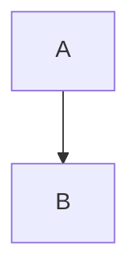

Inline `code` and ``code with ` backtick``.

```dart
void main() {
  print('hello');
}
```

~~~python
def f():
    return 1
~~~

```
no language
```

    indented code block
    second line



```query
tag:#project
```

```base
views:
  - type: table
```

`#not-a-tag` inside code.
